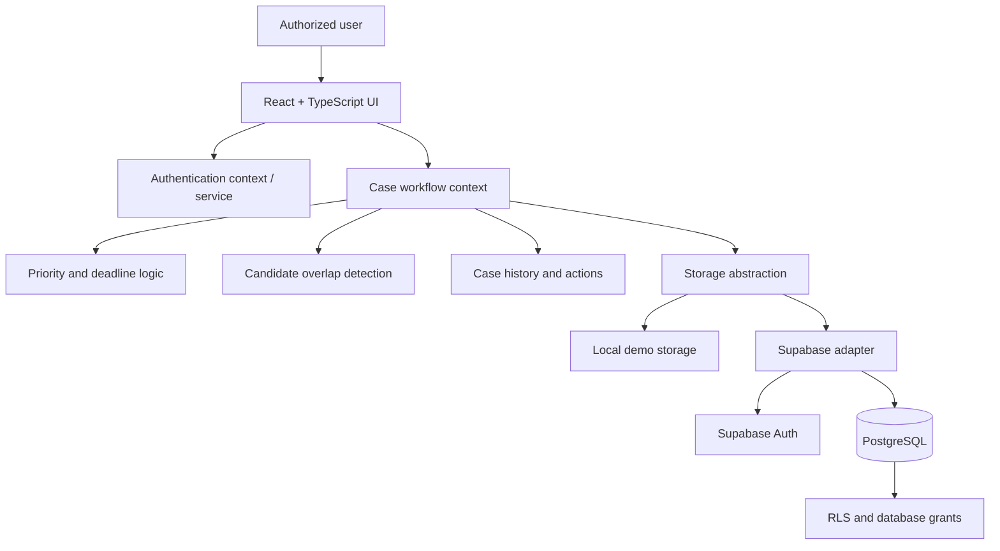

<div align="center">

# CONVERA

### One Institution. Connected Intelligence. Coordinated Action.

**Institution Complaint Monitoring & Cross-Bureau Intelligence Dashboard**  
Smart India Hackathon 2026 · Problem Statement **SIH26264**

[](https://react.dev/)
[](https://www.typescriptlang.org/)
[](https://vitejs.dev/)
[](https://supabase.com/)
[](https://vitest.dev/)
[](https://www.sih.gov.in/)
[](LICENSE)

[](https://convera-olvphbja7-kusoumya2006-netizens-projects.vercel.app/)

[Architecture](docs/ARCHITECTURE.md) · [Master Documentation](PROJECT_MASTER_DOCUMENTATION.md) · [Validation Status](VALIDATION_STATUS.md)

</div>

---

## At a glance

CONVERA is an academic prototype for monitoring institution-related complaints across administrative bureaus/cells. It brings case status, urgency, institution history, potential cross-bureau overlaps, and reporting into one workspace.

**The problem:** teams working in silos can miss concurrent proceedings concerning the same institution, duplicate administrative effort, and lose visibility into deadlines or prior actions.

**The approach:** provide a connected operational view while preserving each complaint's independent identity and keeping coordination decisions with authorized people.

> **Prototype notice:** CONVERA is not an officially endorsed or deployed AICTE system. Dashboard metrics and institution records shown in demonstrations may be synthetic. Do not use the public demo with real or sensitive complaint data.

## Product gallery

The screenshots are the visual record of the application. Add the supplied image files to `docs/assets/screenshots/` using the exact names below; GitHub resolves these relative paths when the assets are committed.

<details open>
<summary><strong>01 · Landing page</strong></summary>


</details>

<details>
<summary><strong>02 · Authentication</strong></summary>


</details>

<details>
<summary><strong>03 · Overview dashboard</strong></summary>


</details>

<details>
<summary><strong>04 · Case registry</strong></summary>


</details>

<details>
<summary><strong>05 · Cross-bureau overlap monitoring</strong></summary>


</details>

<details>
<summary><strong>06 · Completed proceedings</strong></summary>


</details>

<details>
<summary><strong>07 · Institution profiles</strong></summary>


</details>

<details>
<summary><strong>08 · Reports and analytics</strong></summary>


</details>

## Core capabilities

| Capability | What it supports |
|---|---|
| Unified case registry | Search and filter supported complaint records across bureaus |
| Urgency and deadline visibility | Surface overdue and approaching deadlines for review |
| Cross-bureau overlap detection | Flag potentially related active proceedings for human review |
| Institution profiles | View institution information alongside related case activity |
| Case lifecycle and history | Inspect status, resolution, and recorded actions |
| Coordination workflow | Support review and follow-up on overlap alerts |
| Reports and exports | Summarize supported workload/ageing information and export data |
| Demo and cloud storage modes | Support local demonstration and configured Supabase persistence |

**An overlap is a review signal, not a verdict.** CONVERA should not automatically merge, dismiss, or dispose of independent complaints based only on a match.

## System architecture



The architecture and source map are documented in [docs/ARCHITECTURE.md](docs/ARCHITECTURE.md).

## Technology stack

| Layer | Technologies |
|---|---|
| Frontend | React, TypeScript, Vite |
| Styling | Tailwind CSS |
| Charts and icons | Recharts, Lucide React |
| Cloud auth and persistence | Supabase Auth, PostgreSQL |
| Testing | Vitest |
| Deployment configuration | Vercel |

The npm lockfile defines the resolved dependency versions. See [DEPENDENCIES.md](DEPENDENCIES.md).

## Quick start

### Requirements
- Node.js compatible with the repository's Vite/TypeScript toolchain
- npm

### Install and run
```bash
git clone https://github.com/kusoumya2006-netizen/CONVERA-.git
cd CONVERA-
npm ci
npm run dev
```

Useful verification commands:
```bash
npm test
npm run build
npm run preview
```

### Environment setup
The repository includes [`.env.example`](.env.example). For Supabase cloud mode, copy it to `.env.local` and configure the required public project URL and client key:

```bash
cp .env.example .env.local
```

Never place a service-role key, password, or private server secret in a frontend `VITE_*` variable. Cloud behavior depends on the actual project configuration, migrations, grants, RLS policies, and provisioned users.

## Documentation index

| Document | Contents |
|---|---|
| [Project master documentation](PROJECT_MASTER_DOCUMENTATION.md) | Scope, modules, workflows, setup, limitations |
| [Architecture](docs/ARCHITECTURE.md) | Source map, boundaries, and data flow |
| [SIH26264 traceability](docs/SIH26264_REQUIREMENT_TRACEABILITY.md) | Outcomes mapped to implementation and verification |
| [Database schema guide](docs/DATABASE_SCHEMA.md) | Migration review and access-control checks |
| [Demo walkthrough](docs/DEMO_WALKTHROUGH.md) | Suggested evaluator journey |
| [Validation status](VALIDATION_STATUS.md) | Reported results and outstanding checks |
| [Validation checklist](docs/VALIDATION_CHECKLIST.md) | Repeatable local and cloud verification |
| [Dependencies](DEPENDENCIES.md) | Dependency roles and reproducibility |
| [Contributing](docs/CONTRIBUTING.md) | Change and review conventions |

## Validation and known limitations

Previously reported test/build results are summarized in [VALIDATION_STATUS.md](VALIDATION_STATUS.md); they must be re-run against the exact commit used for evaluation. A successful build does not prove live authentication, RLS, multi-user authorization, or cloud persistence.

Before a live demo, follow [the validation checklist](docs/VALIDATION_CHECKLIST.md). Clearly identify synthetic records and disclose any unverified integration.

## License

See [LICENSE](LICENSE). Third-party assets and dependencies may have separate terms.
