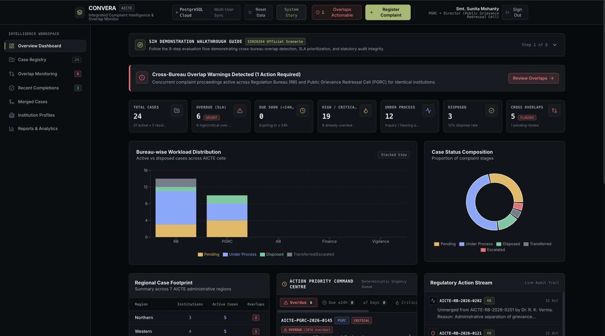
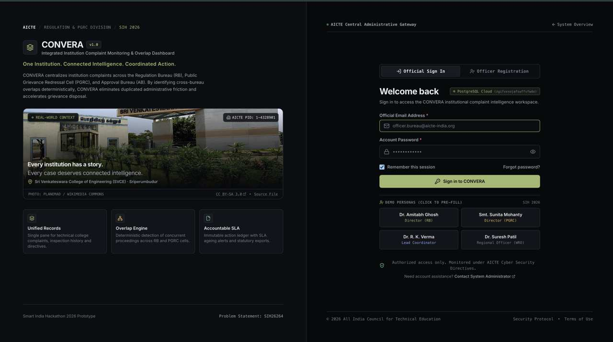
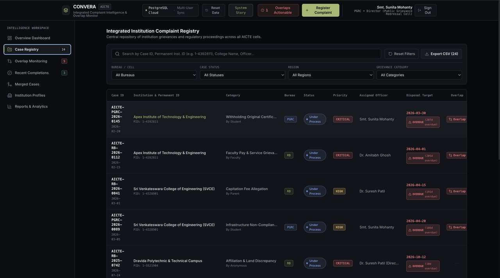
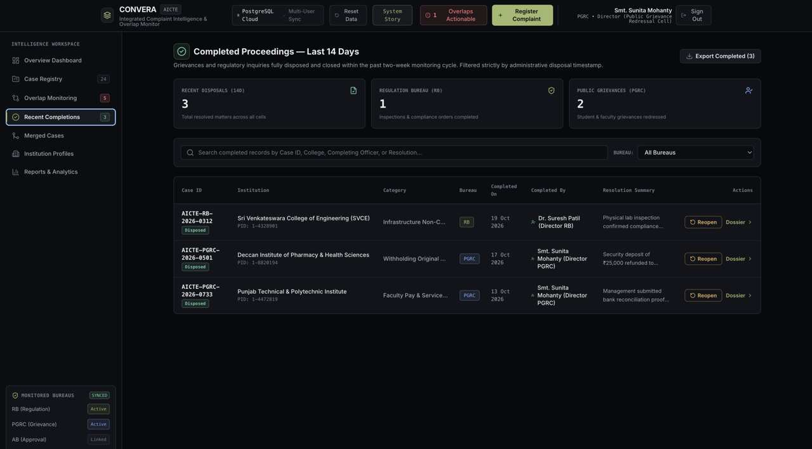
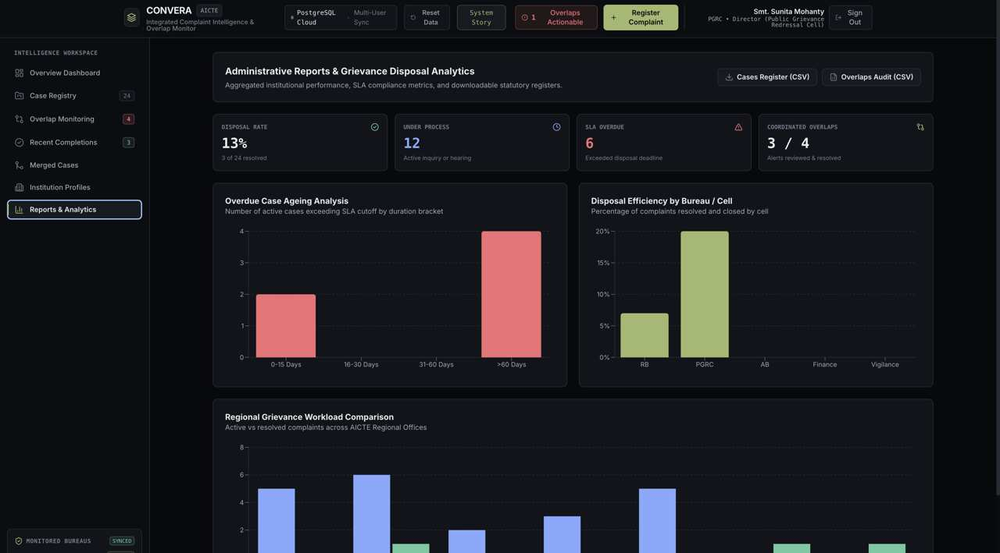
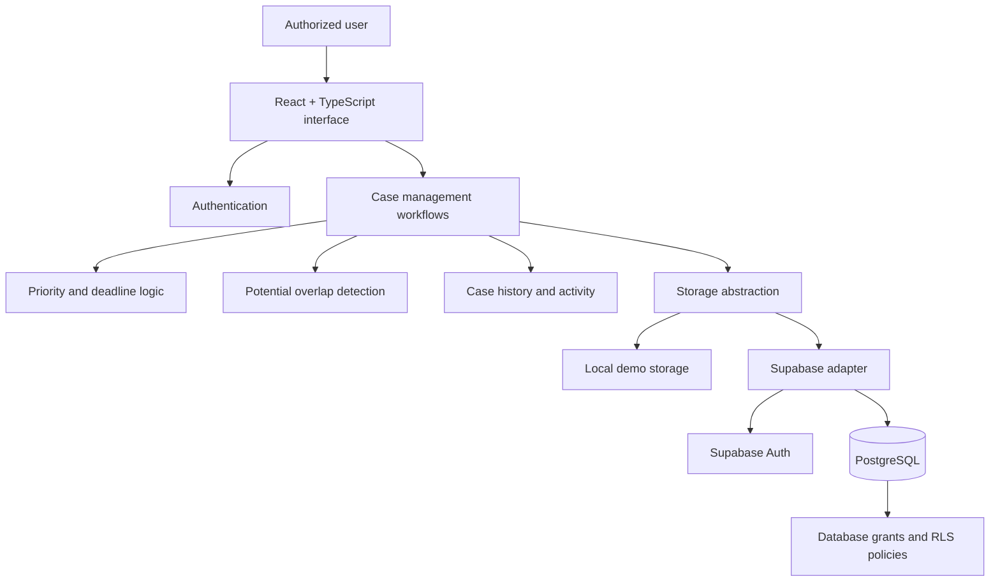

<div align="center">

# CONVERA

### One Institution. Connected Intelligence. Coordinated Action.

**Institution Complaint Monitoring & Cross-Bureau Intelligence Dashboard**

Smart India Hackathon 2026 · Problem Statement **SIH26264**

[Live Demo](https://convera-olvphbja7-kusoumya2006-netizens-projects.vercel.app/) · [Architecture](docs/ARCHITECTURE.md) · [Demo Walkthrough](docs/DEMO_WALKTHROUGH.md) · [Validation Status](VALIDATION_STATUS.md)

</div>

---

## At a glance

CONVERA is an academic prototype for monitoring institution-related complaints across regulatory bureaus and grievance cells. It brings case status, urgency, potential cross-bureau overlaps, institution history, and reporting into one workspace.

<p align="center">
  
</p>

> **Prototype notice:** CONVERA is an SIH 2026 prototype, not an officially endorsed or deployed AICTE system. Demonstration records and dashboard figures may be synthetic. Do not use the demo with real or sensitive complaint data.

## The problem

Institution-related complaints may be handled by separate regulatory bureaus and grievance cells. Without a consolidated view, officials can struggle to identify potentially related proceedings, coordinate follow-up, track deadlines, and reconstruct case history.

CONVERA provides a shared operational view for case monitoring and coordination. It is designed to help authorized users **surface signals and organise work**—not make final administrative decisions on their behalf.

## Core capabilities

| Capability | What it helps users do |
|---|---|
| Consolidated case registry | Search and filter cases across supported bureaus and cells |
| Priority and deadline indicators | Identify urgent, ageing, and overdue work |
| Cross-bureau overlap detection | Surface potentially related proceedings for human review |
| Institution profiles | Review institution details alongside related case activity |
| Case lifecycle and action history | Follow case status changes and recorded activity |
| Coordination workflow | Review overlap signals and record follow-up |
| Reports and exports | Review workload and ageing summaries, including supported CSV exports |
| Local demo and cloud modes | Run with local demo storage or configured Supabase persistence |

**Human review is essential:** an overlap is a signal, not a verdict. CONVERA must not automatically merge, dismiss, or dispose of independent complaints.

## Product tour

The screenshots below are included in the repository so reviewers can inspect the interface directly from GitHub.

<details>
<summary><strong>View all eight screens</strong></summary>

### 01 · Landing page


### 02 · Authentication


### 03 · Overview dashboard


### 04 · Case registry


### 05 · Overlap monitoring


### 06 · Completed proceedings


### 07 · Institution profiles


### 08 · Reports and analytics


</details>

## How it works



The application separates UI workflows from storage so it can support local demo mode and configured Supabase cloud mode. Cloud behavior depends on correct environment variables, database migrations, access policies, and user provisioning.

See [Architecture](docs/ARCHITECTURE.md) for component responsibilities, data flow, deployment modes, and boundaries.

## Technology stack

| Layer | Technologies |
|---|---|
| Frontend | React 18, TypeScript, Vite |
| Styling | Tailwind CSS |
| Charts and icons | Recharts, Lucide React |
| Authentication and cloud persistence | Supabase Auth, PostgreSQL, PostgREST |
| Tests | Vitest |
| Hosting configuration | Vercel |

## Run locally

### Prerequisites

- Node.js compatible with the project's Vite/TypeScript toolchain
- npm
- Git

### Setup

```bash
git clone https://github.com/kusoumya2006-netizen/CONVERA-.git
cd CONVERA-
npm ci
npm run dev
```

Open the local URL printed by Vite.

### Useful commands

```bash
npm test       # Run the automated test suite
npm run build  # Type-check and build the production bundle
npm run preview
```

### Environment variables

The repository includes [`.env.example`](.env.example). For Supabase cloud mode, copy it to `.env.local` and replace the placeholders with the appropriate project URL and public publishable/anon key:

```bash
cp .env.example .env.local
```

Never put a Supabase `service_role` key, private credential, or password in frontend environment variables. Local demo mode and cloud mode have different persistence and security properties; read the architecture and validation notes before a live demonstration.

## Documentation map

| Start here | Use it for |
|---|---|
| [Project master documentation](PROJECT_MASTER_DOCUMENTATION.md) | Project overview, modules, workflows, setup, and limitations |
| [Architecture](docs/ARCHITECTURE.md) | System boundaries, source map, and data flow |
| [SIH26264 requirement traceability](docs/SIH26264_REQUIREMENT_TRACEABILITY.md) | Requirements mapped to implementation and evidence |
| [Database schema](docs/DATABASE_SCHEMA.md) | Schema and access-control review |
| [Demo walkthrough](docs/DEMO_WALKTHROUGH.md) | Suggested evaluation flow |
| [Validation status](VALIDATION_STATUS.md) | Current recorded checks and evidence boundaries |
| [Validation checklist](docs/VALIDATION_CHECKLIST.md) | Repeatable build, workflow, and cloud checks |
| [Dependencies](DEPENDENCIES.md) | Runtime and development dependency inventory |
| [Contributing](docs/CONTRIBUTING.md) | Change and review conventions |

## Validation and limitations

Use [VALIDATION_STATUS.md](VALIDATION_STATUS.md) for the current recorded validation evidence. Passing unit tests and a successful production build do not, by themselves, prove live Supabase authorization, multi-user behavior, or end-to-end deployment correctness. Those must be checked in the target environment.

Before a live demonstration, review the [validation checklist](docs/VALIDATION_CHECKLIST.md), confirm environment configuration and database policies, and use synthetic demonstration records only.

## Contributing

Keep changes focused, preserve case identity and history, and add tests when behavior changes. Follow [CONTRIBUTING.md](docs/CONTRIBUTING.md). Never commit secrets or real complaint data.

## License

Distributed under the repository's [MIT License](LICENSE), unless a specific third-party asset or dependency carries separate terms.
