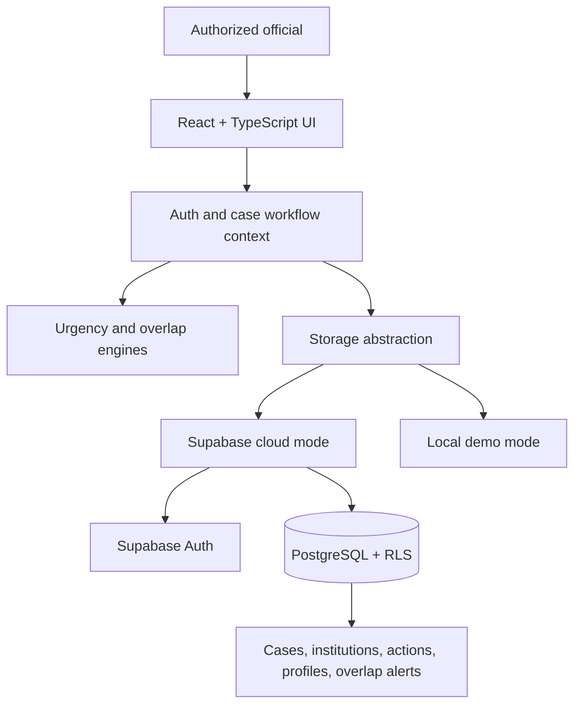

# CONVERA

<p align="center">
  <strong>One Institution. Connected Intelligence. Coordinated Action.</strong><br/>
  An institution complaint-monitoring and cross-bureau coordination prototype for Smart India Hackathon 2026 · SIH26264
</p>

<p align="center">
  <a href="https://react.dev/"></a>
  <a href="https://www.typescriptlang.org/"></a>
  <a href="https://vitejs.dev/"></a>
  <a href="https://supabase.com/"></a>
  <a href="https://vitest.dev/"></a>
  <a href="./LICENSE"></a>
</p>

<p align="center">
  <a href="https://convera-olvphbja7-kusoumya2006-netizens-projects.vercel.app/"><strong>Open the demo</strong></a>
  ·
  <a href="#quick-start">Run locally</a>
  ·
  <a href="./docs/ARCHITECTURE.md">Architecture</a>
  ·
  <a href="./docs/VALIDATION_CHECKLIST.md">Validation checklist</a>
</p>

---

## At a glance

CONVERA gives authorized officials a consolidated operational view of institution-related complaints handled by multiple Bureaus and Cells, including the Regulation Bureau (RB) and Public Grievance Redressal Cell (PGRC).

When separate teams handle cases involving the same institution, duplicated effort, conflicting action, delayed follow-up and unclear ownership can occur. CONVERA is designed to surface possible overlaps, explain why cases may be related, coordinate follow-up and preserve an auditable history—while keeping each complaint's identity and decision history intact.

> **Project status:** Academic prototype for SIH 2026. Feature descriptions below describe the intended/current application workflow; they are not a claim of production certification, formal security audit or government deployment. Validate the deployed environment before using real or sensitive case data.

## Core workflow

1. **Register or review a case** and associate it with the relevant institution and Bureau/Cell.
2. **Prioritize follow-up** using case status, deadlines and urgency indicators.
3. **Surface possible overlaps** between active cases across Bureaus/Cells.
4. **Review the match rationale** before making a coordination decision.
5. **Record officer actions and case history** so updates remain traceable.
6. **Track progress** through the dashboard, filters and supported reports.

## Key capabilities

| Area | What CONVERA is designed to support |
|---|---|
| **Dashboard & urgency queue** | Case counts, status summaries, ageing, deadline visibility and priority-focused views. |
| **Cross-bureau overlap intelligence** | Matching by normalized institution identifiers, with lower-confidence institution-name fallback when an ID is unavailable. |
| **Institution profiles** | A consolidated view of institution details and related case activity. |
| **Case lifecycle** | Case registration, status updates, reassignment, escalation, reopening and recorded resolution details. |
| **Case history** | Chronological activity records for relevant case actions and decisions. |
| **Coordination console** | Lead Bureau/Cell, coordination notes, review decisions and cross-references between cases. |
| **Search & reporting** | Supported filters, dashboard summaries and CSV export. |
| **Authentication & persistence** | Supabase Auth and PostgreSQL for configured cloud mode, with a local demo-storage implementation for development. |

**Safety principle:** An overlap is a review signal, not a verdict. It must not automatically merge, dispose of or dismiss independent complaints. Authorized officials remain responsible for decisions.

## Technology

| Layer | Technology |
|---|---|
| UI | React 18, TypeScript, Vite |
| Styling | Tailwind CSS |
| Charts & icons | Recharts, Lucide React |
| Authentication & database | Supabase Auth, PostgreSQL, PostgREST |
| Persistence | Storage abstraction with Supabase and local demo implementations |
| Automated tests | Vitest |
| Hosting configuration | Vercel |

## Architecture



The application-level engines provide decision support. **Database permissions and Row-Level Security (RLS) must enforce access to persisted records**; hiding a UI control is not a security boundary. See [Architecture and data flow](./docs/ARCHITECTURE.md) for module responsibilities and deployment boundaries.

## Quick start

### Prerequisites

- Node.js 18 or later
- npm 9 or later

### Install and run

```bash
git clone https://github.com/kusoumya2006-netizen/CONVERA-.git
cd CONVERA-
npm install
npm run dev
```

Vite prints the local development URL in the terminal, commonly `http://localhost:5173`.

### Run tests and build

```bash
npm test
npm run build
```

The build runs TypeScript checks before generating production assets in `dist/`. Test and build outcomes can change as the code evolves; use the output from your current checkout rather than relying on previously reported results.

## Configure Supabase cloud mode

1. Create or select the intended Supabase project.
2. Copy `.env.example` to a local `.env` file.
3. Set `VITE_SUPABASE_URL` and `VITE_SUPABASE_ANON_KEY` to the project's URL and browser-safe publishable/anon key.
4. Review the SQL migrations in `supabase/migrations/` in filename order before applying them.
5. Configure Supabase Auth users, application profiles, redirect URLs, database grants and RLS policies for the target environment.
6. Test the required read/write workflows with accounts representing the intended roles.

```bash
cp .env.example .env
```

The local `.env` file is ignored by Git. **Never place a Supabase service-role/secret key, database password or other server credential in a `VITE_*` variable or commit it to the repository.** Vite embeds `VITE_*` values in the browser bundle. Client keys are not a substitute for correct RLS policies and database grants.

Before applying migrations to an existing database, back up important data and review migration assumptions. Do not fix permission errors by disabling RLS or granting unrestricted access. See [Validation checklist](./docs/VALIDATION_CHECKLIST.md) for the minimum checks before a demo.

## Repository map

```text
CONVERA-/
├── public/                  # Static assets served as-is
├── scripts/                 # Demo-data utilities
├── src/
│   ├── components/          # Auth, dashboard, cases, overlaps, reports and UI
│   ├── context/             # Authentication and case workflow state
│   ├── data/                # Synthetic demonstration seed data
│   ├── engine/               # Urgency, overlap and action-history logic + tests
│   ├── services/             # Auth, export and storage adapters + tests
│   ├── types/                # Shared TypeScript types
│   ├── App.tsx
│   └── main.tsx
├── supabase/migrations/     # Database schema, RLS and demo seed migrations
├── docs/                    # Architecture, validation and contributor guidance
├── .env.example             # Safe environment-variable template
├── package.json
├── vercel.json
└── README.md
```

## Demo walkthrough

Use an account provisioned in the connected Supabase Auth project if the deployed demo is configured for cloud mode.

1. Review the dashboard and urgency queue.
2. Open overlap monitoring and inspect cases associated with the same institution.
3. Review the match explanation before opening the coordination workflow.
4. Record a coordination decision where appropriate.
5. Open a case and inspect its activity history.
6. Make an allowed case update, refresh, and confirm the change persists.
7. When validating cloud mode, verify the expected record and permissions in Supabase.

Demo institutions, cases, officers, deadlines and outcomes are synthetic/fictional examples. Do not interpret them as actual AICTE records. The live deployment may require environment configuration and provisioned accounts.

## Validation and security

Before presenting a build as ready, verify more than the landing page:

- [ ] `npm test` passes on the current commit.
- [ ] `npm run build` completes without errors.
- [ ] Login and protected-route behavior work for intended roles.
- [ ] Case creation, updates, reassignment, escalation and reopening persist as expected.
- [ ] Case history records the correct action, actor and timestamp.
- [ ] Overlap alerts are explainable and never trigger automatic disposal or merging.
- [ ] Cloud writes report success only after required persistence succeeds.
- [ ] RLS and database grants are tested against allowed and denied operations.
- [ ] Direct route refresh and deployment environment variables are checked.
- [ ] The demo uses synthetic data and contains no secrets.

The [validation checklist](./docs/VALIDATION_CHECKLIST.md) provides a repeatable evidence log. Do not claim a check passed unless it was actually run and its result was reviewed.

## Deployment

The repository includes a root-level `vercel.json` for the Vite single-page application.

1. Import this repository into Vercel.
2. Use the repository root as the project root.
3. Set the build command to `npm run build` and output directory to `dist`.
4. Add the required environment variables for the target environment.
5. Configure the production URL and allowed redirect URLs in Supabase Auth.
6. Test login, direct-route refresh, case writes and history against the deployed environment.

Changing Vite environment variables requires a new build/deployment.

## Known limitations and roadmap

CONVERA is an SIH prototype, not an official AICTE service. Before production use, the project needs environment-specific security review, permission testing, end-to-end workflow verification, monitoring and operational approval. Potential follow-up work includes more granular overlap feedback, configurable SLA rules and notification delivery, transactional handling of multi-step writes, expanded reporting, secure attachments, accessibility improvements and additional automated RLS/E2E coverage.

## Attribution

The project uses an SVCE campus entrance image attributed to PlaneMad via Wikimedia Commons under the [Creative Commons Attribution-ShareAlike 3.0 license](https://creativecommons.org/licenses/by-sa/3.0/). See the [original file page](https://commons.wikimedia.org/wiki/File:SVCE_entrance_close_up.jpg) for attribution and license details.

## License

Distributed under the MIT License. See [LICENSE](./LICENSE).

---

<p align="center"><strong>CONVERA · One Institution. Connected Intelligence. Coordinated Action.</strong></p>
