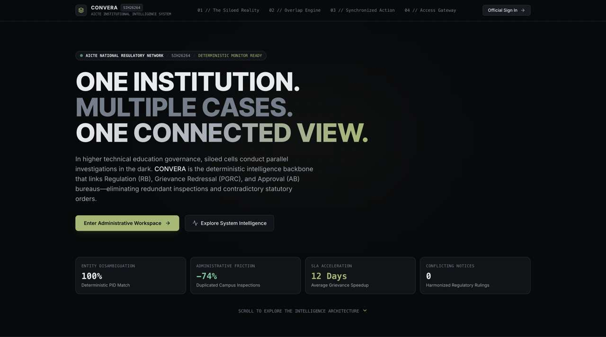
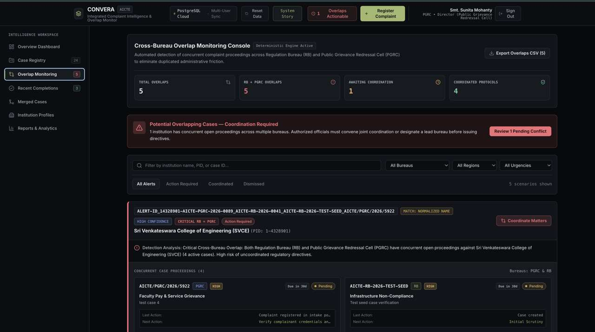
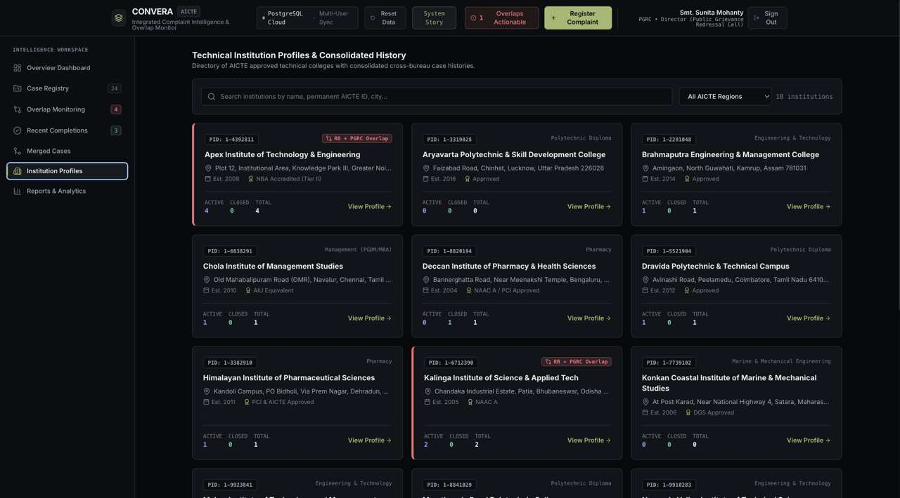
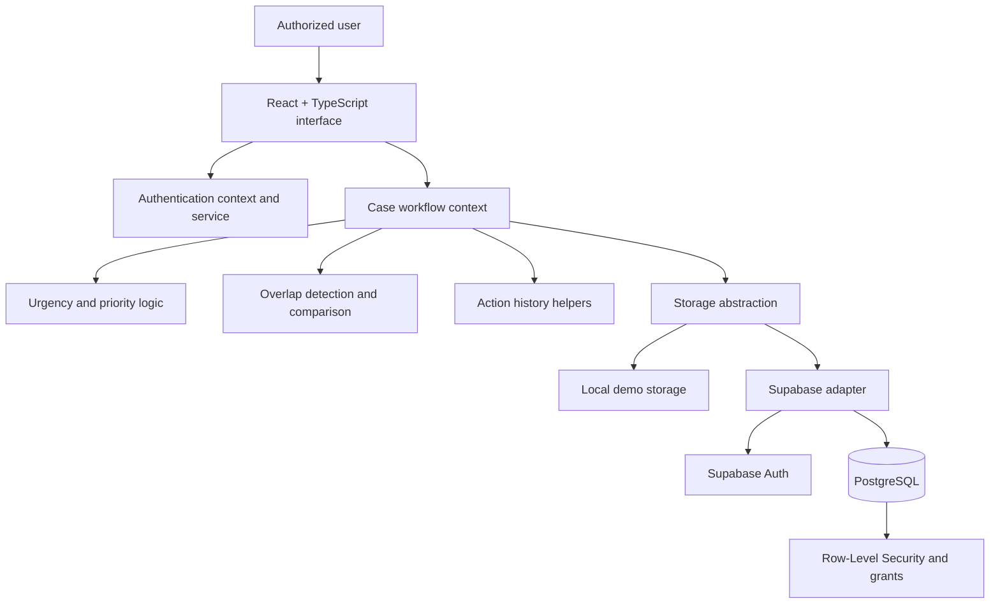

<div align="center">

# CONVERA

### One Institution. Connected Intelligence. Coordinated Action.

**Institution Complaint Monitoring & Cross-Bureau Intelligence Dashboard**  
Smart India Hackathon 2026 · Problem Statement **SIH26264**

[](https://react.dev/)
[](https://www.typescriptlang.org/)
[](https://vitejs.dev/)
[](https://supabase.com/)
[](https://vitest.dev/)
[](https://sih.gov.in/)
[](LICENSE)

[](https://convera-olvphbja7-kusoumya2006-netizens-projects.vercel.app/)\n\n[Architecture](docs/ARCHITECTURE.md) · [Master Documentation](PROJECT_MASTER_DOCUMENTATION.md) · [Validation Status](VALIDATION_STATUS.md)

</div>

---

## The problem

Institution-related complaints can be handled by separate regulatory bureaus and grievance cells. Without a consolidated view, officials may struggle to spot concurrent proceedings, coordinate action, follow deadlines, and reconstruct case history.

**CONVERA** is an academic prototype for monitoring institution-related complaints across the Regulation Bureau (RB), Public Grievance Redressal Cell (PGRC), and related administrative units. It brings case status, urgency, potential cross-bureau overlaps, institution history, and reporting into one workspace.

> **Prototype notice:** CONVERA is an SIH 2026 prototype, not an officially endorsed or deployed AICTE system. Dashboard figures and institution records shown in demonstrations may be synthetic. Do not use the demo with real or sensitive complaint data.

## Product tour

The product gallery is built around the actual CONVERA UI screenshots. Keep the original captures in `docs/assets/screenshots/` with the filenames below; do not replace them with generated mockups.

| Screen | What it demonstrates |
|---|---|
| Landing page | Product purpose and entry points |
| Authentication | Official sign-in and demo persona flow |
| Overview dashboard | Workload, urgency, case status, and action stream |
| Case registry | Searchable and filterable consolidated case list |
| Overlap monitoring | Potential cross-bureau conflicts and coordination review |
| Completed proceedings | Recently disposed cases and resolution summaries |
| Institution profiles | Institution records and consolidated case history |
| Reports & analytics | SLA ageing, bureau workload, and export options |

### Screenshots


<details>
<summary>View product screenshots</summary>

#### 01 · Landing page


#### 02 · Authentication


#### 03 · Overview dashboard


#### 04 · Case registry


#### 05 · Overlap monitoring


#### 06 · Completed proceedings


#### 07 · Institution profiles


#### 08 · Reports and analytics


</details>

## Core capabilities

| Capability | Purpose |
|---|---|
| Consolidated case registry | Search and filter cases across supported bureaus/cells |
| Priority and deadline indicators | Bring overdue and urgent work into view |
| Cross-bureau overlap detection | Surface potentially related active proceedings for human review |
| Institution profiles | Show institution information alongside related case activity |
| Case lifecycle and history | Support status changes and a traceable sequence of actions |
| Coordination workflow | Help authorized users review overlaps and record follow-up |
| Reports and exports | Present workload and ageing summaries with supported CSV exports |
| Local demo and cloud modes | Support standalone demonstration and configured Supabase persistence |

**Important:** an overlap is a review signal, not a verdict. It must not automatically merge, dismiss, or dispose of independent complaints. Authorized officials remain responsible for decisions.

## How it fits together



See [Architecture](docs/ARCHITECTURE.md) for module responsibilities, deployment modes, data flow, and safety boundaries.

## Technology stack

| Layer | Technologies |
|---|---|
| Frontend | React 18, TypeScript, Vite |
| Styling | Tailwind CSS |
| Charts and icons | Recharts, Lucide React |
| Cloud authentication and persistence | Supabase Auth, PostgreSQL, PostgREST |
| Testing | Vitest |
| Hosting configuration | Vercel |

The application uses a storage abstraction for local demo and configured Supabase modes. Cloud-mode behavior depends on valid environment configuration, applied migrations, provisioned users, database grants, and RLS policies.

## Quick start

### Requirements

- Node.js compatible with the project's Vite/TypeScript toolchain
- npm
- Git

### Install and run

```bash
git clone https://github.com/kusoumya2006-netizen/CONVERA-.git
cd CONVERA-
npm ci
npm run dev
```

Use the local URL printed by Vite. The project also defines:

```bash
npm test
npm run build
npm run preview
```

The build script runs TypeScript checking before creating the Vite production bundle.

### Environment configuration

The repository includes [`.env.example`](.env.example). Copy it to `.env.local` only if you are configuring Supabase cloud mode, then replace the placeholders with your project's public URL and publishable/anon key.

```bash
cp .env.example .env.local
```

Never put a Supabase `service_role` key, private credential, or password in frontend environment variables. Local demo mode and cloud mode have different persistence and security properties; see [Architecture](docs/ARCHITECTURE.md).

## Documentation

| Document | Purpose |
|---|---|
| [Project master documentation](PROJECT_MASTER_DOCUMENTATION.md) | Project overview, modules, workflows, setup, and limitations |
| [Architecture](docs/ARCHITECTURE.md) | System boundaries, source map, and data flow |
| [SIH26264 traceability](docs/SIH26264_REQUIREMENT_TRACEABILITY.md) | Requirements mapped to implementation and evidence |
| [Database schema](docs/DATABASE_SCHEMA.md) | Migration-led schema and access-control review guide |
| [Demo walkthrough](docs/DEMO_WALKTHROUGH.md) | Suggested evaluation flow using the UI |
| [Validation status](VALIDATION_STATUS.md) | Automated and manual checks, with evidence boundaries |
| [Validation checklist](docs/VALIDATION_CHECKLIST.md) | Repeatable build, workflow, and cloud verification |
| [Dependencies](DEPENDENCIES.md) | Runtime and development dependency inventory |
| [Contributing](docs/CONTRIBUTING.md) | Change and review conventions |

## Validation and limitations

Use [VALIDATION_STATUS.md](VALIDATION_STATUS.md) for the current evidence-backed state. Automated unit tests and a successful production build do not, by themselves, prove live Supabase authorization, multi-user behavior, or end-to-end deployment correctness. Those checks must be run against the target environment.

Known deployment dependencies include Supabase configuration, database migrations, RLS and grants, user/profile provisioning, and authentication redirect settings. Review the [validation checklist](docs/VALIDATION_CHECKLIST.md) before a live demonstration.

## Contributing

Keep changes focused, preserve case identity and history, and add tests for behavior changes. Follow [CONTRIBUTING.md](docs/CONTRIBUTING.md). Never commit secrets or real complaint data.

## License

Distributed under the repository's [MIT License](LICENSE), unless a specific third-party asset or dependency carries separate terms.
