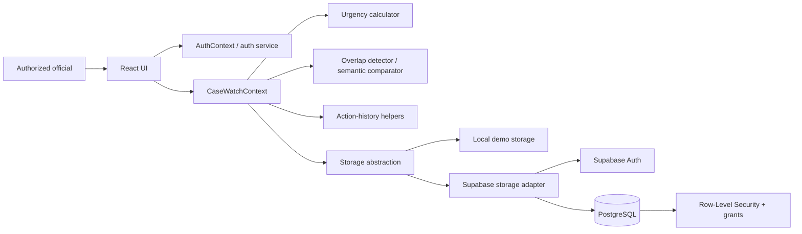

# CONVERA Architecture

This document describes the current repository structure and the intended boundaries between UI, application logic and persistence. It is an implementation guide, not a claim that every deployment has been independently security- or load-tested.

## System context

## Code map

| Location | Responsibility |
|---|---|
| `src/App.tsx` | App shell and route/view composition |
| `src/components/auth/` | Login, protected-route and auth presentation components |
| `src/components/dashboard/` | Overview, metrics, workload and activity views |
| `src/components/cases/` | Case details, actions and history interactions |
| `src/components/registry/` | Case registry, filtering and case creation |
| `src/components/overlaps/` | Overlap review and coordination UI |
| `src/components/institutions/` | Institution directory and details |
| `src/components/reports/` | Reporting UI |
| `src/context/AuthContext.tsx` | Auth state and app-level auth coordination |
| `src/context/CaseWatchContext.tsx` | Shared case workflow state and orchestration |
| `src/engine/urgencyCalculator.ts` | Deadline/urgency calculations |
| `src/engine/overlapDetector.ts` | Candidate overlap detection |
| `src/engine/semanticComparator.ts` | Similarity comparison used by overlap analysis |
| `src/engine/actionHistoryHelper.ts` | Action-history construction and audit-oriented helpers |
| `src/services/authService.ts` | Auth service boundary |
| `src/services/storage/` | Local and Supabase storage implementations and shared types |
| `src/services/exportService.ts` | Export utilities |
| `src/types/` | Shared domain and auth types |
| `supabase/migrations/` | Schema, RLS policies and synthetic/demo seed migrations |
| `scripts/` | Demo-data utilities |
| `docs/` | Architecture, validation and contributor process |

## Main data flow

1. A user interacts with the React UI.
2. Auth and case workflow contexts coordinate state and service calls.
3. Application engines calculate urgency and identify potential overlaps; they provide decision support, not final regulatory decisions.
4. The storage abstraction routes operations to local demo storage or the configured Supabase adapter.
5. In cloud mode, Supabase Auth identifies the user and PostgreSQL/RLS/grants must enforce access to records.
6. Case-action/history workflows should retain the actor, action, timestamp and relevant details needed to reconstruct what happened.

## Cloud and demo modes

- **Local demo mode:** useful for development and synthetic demonstrations. Browser-local persistence is not a shared, authoritative multi-user database.
- **Supabase cloud mode:** intended for shared persistence. It depends on valid environment variables, provisioned auth users/profiles, correct schema migrations, RLS policies, database grants and auth redirect configuration.

Do not assume cloud mode is secure simply because login works. Test both permitted and forbidden operations using separate accounts and verify the database state after writes.

## Safety and integrity rules

- An overlap alert must not automatically merge or dispose of a complaint.
- A UI role check is not an authorization boundary; enforce access in database policies too.
- Show a successful save only after the required write has succeeded.
- For workflows that write multiple related records, test partial-failure behavior and document whether operations are transactional or compensating.
- Preserve the individual identity and history of cases even when they are cross-referenced.
- Use synthetic records in public demonstrations; do not commit secrets or real sensitive complaint data.

## Change discipline

When changing the architecture, prefer small, isolated commits. Add or update tests for logic changes, update the validation checklist for workflow changes, and keep this document synchronized with actual code. Do not rename or move source folders solely for visual neatness without checking imports, build configuration and deployment behavior.
