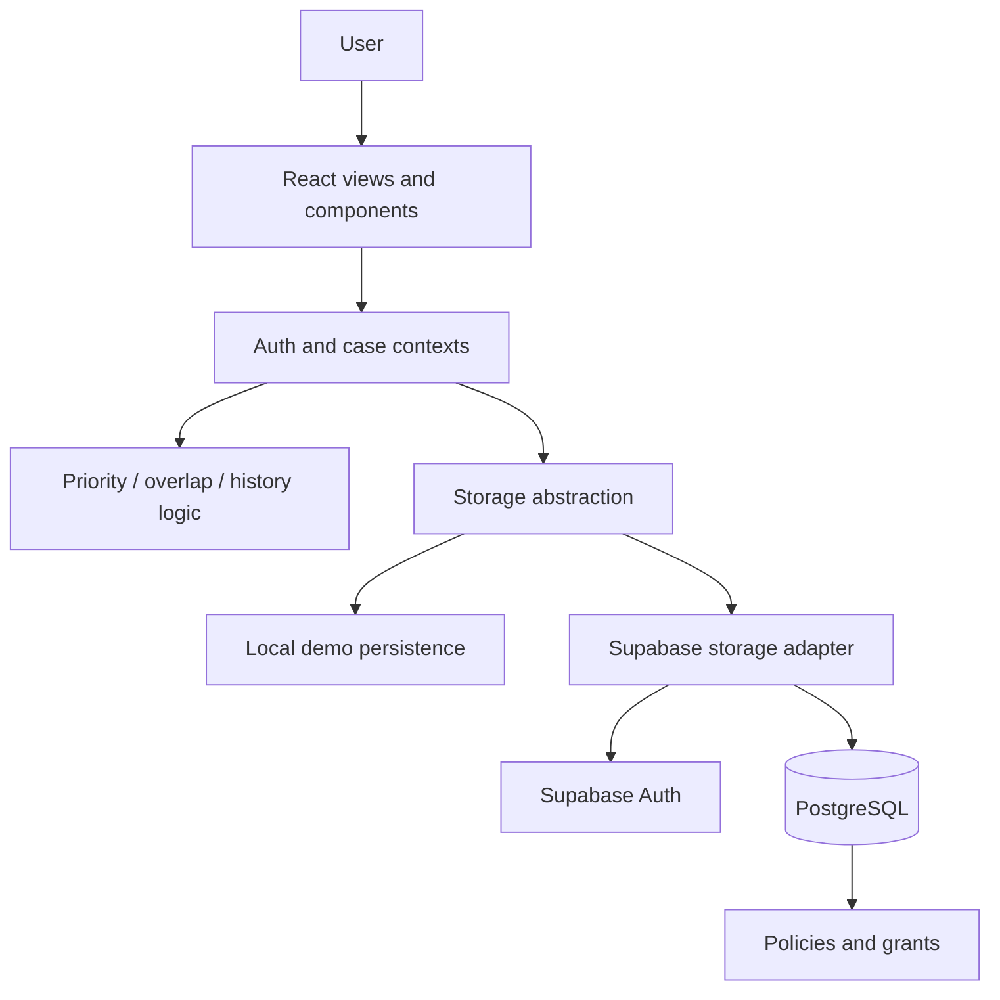

# CONVERA Architecture

> A practical source map for the current React/TypeScript prototype. Confirm implementation details against the active branch before making architectural claims.

## 1. Architectural goals

- Provide a unified operational view across supported complaint bureaus/cells.
- Keep presentation, decision-support logic, and persistence concerns separated.
- Make potential overlaps visible for human review without automatically merging independent cases.
- Support local demonstration and a separately configured cloud mode.
- Treat database policies—not frontend visibility—as the authority for cloud access.

## 2. High-level component view

The diagram shows logical responsibilities. It does not imply that every environment has live cloud connectivity or that database policies have been independently security-audited.

## 3. Main layers

| Layer | Responsibility | Verification |
|---|---|---|
| UI | Dashboards, case tables, forms, profiles, charts | Browser walkthrough and component tests |
| Shared state | Auth/session state and case workflow coordination | Context/service tests and route smoke tests |
| Decision support | Urgency, deadline indicators, overlap candidates | Unit tests for boundary cases and false positives |
| Storage adapter | Routes operations to the configured persistence implementation | Adapter tests and create/update/reload scenarios |
| Supabase | Auth and PostgreSQL persistence in configured cloud mode | Migration inspection, RLS/grant tests, multi-user checks |
| Build/test | TypeScript, Vite, Vitest | Run current package scripts on the evaluation commit |

## 4. Data flow

1. A user opens a dashboard or selects a case/institution.
2. The UI reads state through shared application contexts and services.
3. Decision-support logic derives urgency or candidate overlap information from available records.
4. The storage abstraction sends reads/writes to the active demo or cloud adapter.
5. The UI presents the outcome and any validation/error state exposed by the service.
6. Where supported, case actions and coordination decisions remain inspectable in the record history.

## 5. Overlap detection boundary

Overlap detection identifies candidates that deserve review. Institution identifiers, normalized names, bureau, status, and other implemented matching inputs should be understood from the actual engine source and tests. A candidate match can be a false positive or miss a true relationship.

**Required safety property:** an overlap signal alone must not merge or dispose of separate cases. Human review and an explicit authorized workflow remain necessary.

## 6. Persistence modes

### Local demonstration
Useful for UI walkthroughs and seeded synthetic data. Do not assume local state is shared between users or durable across browser resets unless the active implementation explicitly provides that behavior.

### Supabase cloud
Requires correct public client configuration, ordered migrations, provisioned users, database grants, RLS policies, and authentication redirect settings. Frontend route guards do not replace database authorization.

## 7. Security and privacy

- Never commit secrets or real complaint records.
- Never expose a service-role key through a frontend environment variable.
- Test allowed and denied operations using separate accounts.
- Confirm failed writes are visible to the user and not presented as successful.
- Treat demonstration institution names and metrics as illustrative unless independently verified.

## 8. Further reading

- [Project master documentation](../PROJECT_MASTER_DOCUMENTATION.md)
- [Database schema review](DATABASE_SCHEMA.md)
- [Requirement traceability](SIH26264_REQUIREMENT_TRACEABILITY.md)
- [Validation status](../VALIDATION_STATUS.md)
